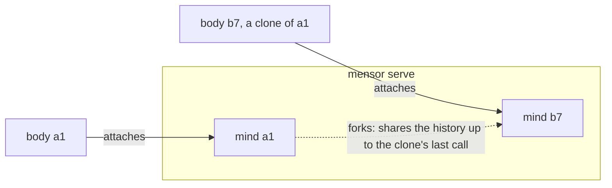

# mensor

mensor runs AI agents as pairs: a **mind** that holds the history and calls
the model, and a **body** that does what the mind asks. One mind drives one
body. When a body is cloned, the clone attaches under a new name and the mind
forks to match, so each clone carries on with a mind of its own.

How a body is cloned is not mensor's concern. A cloned VM, a copied directory
and a second process all work: whoever makes the copy feeds it a new name.



## Quick start

Needs Rust 1.97 (`rust-toolchain.toml` pins it) and a model's credential.

The shortest way in is one process that hosts the minds and runs one body:

```bash
export ANTHROPIC_API_KEY="$(cat path/to/anthropic.key)"
mkdir -p /tmp/demo
cargo run -p mensor -- run --name a1 --dir /tmp/demo --store build/mensor.sqlite
```

That body's commands run on this machine as you, beside a process that holds
the model's credentials, so use it where you trust the model. To keep them
apart, run the host and the body as two processes:

```bash
cargo run -p mensor -- serve --store build/mensor.sqlite
```

In a second shell, run a body. It dials the host, and a pair named `a1` is
born:

```bash
mkdir -p /tmp/demo
cargo run -p mensor -- body --name a1 --dir /tmp/demo
```

Either way, prompt the pair from another shell and follow its history:

```bash
api=127.0.0.1:7878/v1/pairs
curl -s -X POST $api/a1/prompt -H 'content-type: application/json' \
  -d '{"key":"1","text":"Write a haiku to haiku.txt."}'
curl -sN $api/a1/events      # every item, and each reply as the model writes it
curl -s -X POST $api/a1/interrupt    # stop the turn it is in
```

Now clone the body. This copy takes the files and starts a new process:

```bash
cp -r /tmp/demo /tmp/demo2
cargo run -p mensor -- body --name b7 --cloned-from a1 --dir /tmp/demo2
curl -s $api                 # a1, and b7 forked from it
curl -s -X POST $api/b7/prompt -H 'content-type: application/json' \
  -d '{"text":"Translate it into French."}'
```

A clone that keeps its memory, such as a VM snapshot, keeps the running body
process and everything it was doing. Start the body with `--name-file`, have
whatever makes the clone write the new name there, and send the body
`SIGHUP`: it reads the file and says hello again under the new name.

## Models

A mind asks its model through one of two APIs, chosen by the credential it
is given:

| Variable | API | Address |
| --- | --- | --- |
| `ANTHROPIC_API_KEY` or `ANTHROPIC_AUTH_TOKEN` | Claude's Messages API | `ANTHROPIC_BASE_URL`, or Anthropic's |
| `OPENAI_API_KEY` | Chat Completions, which OpenAI, OpenRouter and most other servers speak | `OPENAI_BASE_URL`, or OpenAI's |

With both set it is the Messages API, unless `MENSOR_API=chat`. `--model`
names the model, and is `claude-opus-5-5` unless given:

```bash
export OPENAI_API_KEY="$(cat path/to/openai.key)"
cargo run -p mensor -- run --model gpt-5.5 --name a1 --dir /tmp/demo
```

**A reply is told as it is written.** Every model request is streamed.
Between the items of `/events` come `writing` events, which have no id:
`{"at", "text"}`, the next piece of the reply and how many bytes of it came
before. A piece at 0 starts a reply, or starts it over when the model had
to be asked again, and the step that is stored when the reply ends replaces
all of it. A client that wants only the history ignores them.

**A long conversation is summed up.** Once a request would hold
`--compact-at` tokens (150,000 unless given, and never when zero), the mind
asks its model for a summary and carries on from that, with every prompt
the model had not answered yet kept as it was said. For a server that does
not say what a step read, the mind counts a token for every two bytes. The whole history stays
in the store, and the mind lets go of what the summary replaced: a summary
names the index a mind starts from, so a mind holds, and a host loads, only
the items from there.

**Memory follows the pairs at work.** A host starts knowing only the names
of its pairs. A pair is loaded when its body dials in or something is asked
of it, and leaves memory a minute after it has no body connected, nobody
following it and no model asked. What a resting pair is doing is read from
the store. With 20,000 pairs stored, `mensor-mind` started in 12 ms and held
10 MB; through a conversation of 36 MB it held 20 MB. What a host frees it
gives back to the system twice a minute: 300 pairs awake held 244 MB, and
12 MB once they rested. A clone's mind is forked from its parent's history
a page at a time, so forking a pair costs the same however long its history.

**The store is one SQLite file.** Each item is a row of `items`: its `pair`
and index `at`, the `time` it was stored (ms since 1970), its `kind`, the
`key` of a prompt that has one, and the `item` itself as JSON. `GET
/v1/pairs/{name}/history?after=` answers 512 items at the most, with the
cursor to read on from. An append is on disk when it returns, and appends
that arrive together share one wait for the disk: on a disk that takes
4.5 ms to sync, one pair stores 210 appends a second and 64 pairs at once
store 6,200. A read waits for no write.

**A step's results are shown in 96 KB at the most**, shared equally between
the tools that step used. A longer result is shown with its middle left
out, and the history keeps it whole. That bounds what one round can add, so
the summary is asked for while a model that reads 200,000 tokens still has
room for it.

**A turn can be stopped.** `POST /v1/pairs/{name}/interrupt` gives up the
model's reply, kills the commands the body runs for the turn, and leaves the
mind idle until its next prompt, which reads how the turn ended. A body that
is away when its turn is stopped is told when it is back.

## Binaries

`make build` makes three, so that a machine carries only the half it runs:

| Binary | Does | Size |
| --- | --- | --- |
| `mensor` | `serve`, `body` and `run` | 4.7 MB |
| `mensor-mind` | `mensor serve` alone | 4.3 MB |
| `mensor-body` | `mensor body` alone, on one thread | 2.3 MB |

They take the flags of the subcommands they stand for. Sizes are for
x86-64 Linux, stripped. Each logs to standard error at `info`, or at the
level `MENSOR_LOG` names: `trace`, `debug`, `warn`, `error` or `off`.

## On Cloudflare

The same pair runs with no server and no socket: each pair is one Durable
Object that holds the mind, the body and the body's files in its own SQLite
database. Needs Node, and `make tools` for worker-build.

```bash
cd crates/cloudflare
env -i PATH="$PATH" HOME="$HOME" CLOUDFLARE_INCLUDE_PROCESS_ENV=true \
  ANTHROPIC_API_KEY="$(cat path/to/anthropic.key)" \
  npx wrangler dev                      # on this machine, at 127.0.0.1:8787
```

`env -i` matters: that variable hands the worker every variable of the shell
that starts it.

The API is the one above, so the same `curl` commands prompt a pair and
follow it. The first prompt to a name starts its pair. See
[docs/cloudflare.md](docs/cloudflare.md) for how an object works, recovers
and deploys.

## The rules

- **One mind, one body.** A clone gets a mind of its own.
- **A new name is a new body.** The host never issues or checks names. A name
  it knows is a reconnect, a new one that names its original is a clone, and
  any other new one starts a pair.
- **New minds start idle.** A forked mind settles what its body still holds
  or runs, then waits for a prompt.
- **A limit on clones.** Past `--max-clones` in one lineage, a clone is
  refused. Zero turns forking off, leaving plain pairs.
- **Store before send.** A call is in the history before it is sent, and a
  body refuses an id it has read, so no call runs twice.
- **Nothing is guessed.** A call that may have run without a result is
  recorded as unknown, and the model is told to check before trying again.

## Capabilities

A body is a small core plus capabilities, which its hello lists. The mind
shows each operation to the model as a tool.

| Capability | Operations | On a real machine |
| --- | --- | --- |
| `commands` | `bash` | Runs a command, with a timeout, and kills everything it started when cancelled |
| `files` | `read`, `write`, `edit`, `list` | Reads and changes files under the body's directory |

In a Durable Object the names are the same and the backing differs:

| Capability | Operations | In a Durable Object |
| --- | --- | --- |
| `files` | `read`, `write`, `edit`, `list` | Reads and changes rows in the object's database |
| `fetch` | `fetch` | Makes an HTTP request with the platform's `fetch` |

A capability is a Rust trait with two methods, so a body elsewhere can back
the same names with something else.

`mensor body` and `mensor run` keep the host's token and the model's
credentials out of the environment of every command. That is not a sandbox:
confining a body is left to whoever runs it.

## Layout

| Crate | Holds |
| --- | --- |
| `mensor-protocol` | The messages a mind and a body exchange, and the rule that settles a connection. Pure. |
| `mensor-mind` | The history, the turn loop and the fork as a state machine, and the store trait. Pure. |
| `mensor-body` | What a body remembers, the capability trait, and `files` over any place that holds bytes. Pure. |
| `mensor-model` | Claude's Messages API and Chat Completions, as requests to send and answers to read, with the retries. Pure. |
| `mensor-api` | The bodies of the HTTP API's requests and answers, which both hosts serve alike. Pure. |
| `mensor-object` | A mind and its body as one object over a storage trait, for a host that keeps a whole pair in one place. Pure. |
| `mensor-mind-host` | The server: one task per pair, the attach endpoint, the HTTP API, the model's HTTP client. |
| `mensor-body-host` | A body on a real machine: the driver, the WebSocket dial, `commands` and files on disk. |
| `mensor-cloudflare` | The Cloudflare worker: each pair is one Durable Object, with `files` in its database and `fetch`. |
| `mensor-store-sqlite` | Every history in one SQLite file. A fork stores only its own items. |
| `mensor` | The `mensor`, `mensor-mind` and `mensor-body` binaries, the in-process dial, and the end-to-end tests. |

The six pure crates do no I/O and read no clock, so their tests drive them
directly and a different host can reuse them. The Cloudflare worker is that
reuse: it shares every rule with the server, and adds only storage, `fetch`
and an alarm.

## Not built yet

- The Responses API.
- Deleting a pair.
- More capabilities (`skills`, `fetch` on a real machine), and capabilities
  the host supplies instead of the body.
- In a Durable Object: clones and forks, a remote body attaching to the
  object's mind, and listing pairs.

MCP is not planned. A capability is a Rust trait a body is built with.

## Docs

- [docs/protocol.md](docs/protocol.md): the protocol between a mind and a body.
- [docs/cloudflare.md](docs/cloudflare.md): a pair as one Durable Object.
- [AGENTS.md](AGENTS.md): commands, layout and rules for working here.

## License

[MIT](LICENSE)
