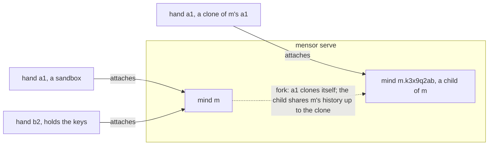

# mensor

mensor runs AI agents as minds with hands. A **mind** holds the history and
calls the model. A **hand** does what the mind asks: it runs commands and
changes files on a machine. A mind drives up to four hands at once, each
somewhere else, and its model says which hand runs each call.

A mind also has tools of its own. With `fork`, the model splits the work:
it asks a hand to **clone** itself, and each clone starts a child mind that
shares the history up to that point and carries on with its own prompt.
With `wait`, the parent reads what its children said once they are done,
and with `tell` a parent and its children send each other messages. With
`clone_hand`, a clone joins the same mind instead, as another hand, and
`release_hand` lets one go.



## Quick start

Needs Rust 1.97 (`rust-toolchain.toml` pins it) and a model's credential.

The shortest way in is one process that hosts the minds and runs one hand,
named `local`, for the mind `main`:

```bash
export ANTHROPIC_API_KEY="$(cat path/to/anthropic.key)"
mkdir -p /tmp/demo
cargo run -p mensor -- run --dir /tmp/demo --store build/mensor.sqlite
```

That hand's commands run on this machine as you, beside a process that holds
the model's credentials, so use it where you trust the model. To keep them
apart, run the host and each hand as processes of their own:

```bash
cargo run -p mensor -- serve --store build/mensor.sqlite
```

In other shells, run hands. Each dials the host and names its mind and
itself. The first hand to name a mind starts it:

```bash
mkdir -p /tmp/a1 /tmp/b2
cargo run -p mensor -- hand --mind m --hand a1 --dir /tmp/a1
cargo run -p mensor -- hand --mind m --hand b2 --dir /tmp/b2
```

Then prompt the mind and follow its history:

```bash
api=127.0.0.1:7878/v1/minds
curl -s -X POST $api/m/prompt -H 'content-type: application/json' \
  -d '{"key":"1","text":"Write a haiku in a1 and a limerick in b2."}'
curl -sN $api/m/events      # every item, and each reply as the model writes it
curl -s $api/m              # what it is doing, its hands, and those it waits for
curl -s -X POST $api/m/interrupt    # stop the turn it is in
```

Ask it to fork, and each child appears beside it:

```bash
curl -s -X POST $api/m/prompt -H 'content-type: application/json' \
  -d '{"text":"Fork from a1: one child translates the haiku into French, one into German. Wait for both, then pick the better one."}'
curl -s $api                # m, and its children m.<code>
```

## Hands

**Calls to different hands run at once.** A step's tool uses are issued in
order, but one waits only for an earlier one on the same hand. Every hand
tool takes a `hand` argument, which may be left out while the mind has one
hand. Hand names never appear in a tool's definition, so the tools stay the
same as hands come and go, and a model's prompt cache survives them.

**A hand that is away holds up only its own calls.** They wait, unsent,
until it is back, and an interrupt ends them as not run. A mind whose hands
are all away waits for one of them before it asks its model. A hand that
dies while it runs a call can be let go from outside with `POST
/v1/minds/{name}/release {"hand": "a1"}`: its unanswered calls are recorded
as unknown, the turn goes on, and the hand is refused if it comes back. A
mind that has let every hand go still talks, with no tools.

**A mind has up to `--max-hands` hands** (four unless set). One more is
refused. The model is told when a hand joins, and what it can do.

## Forks

`fork` and `clone_hand` ask a hand to clone itself through its `clone`
capability, which copies the hand's directory and starts a hand on the copy.
The mind's own tools are offered only while one of its hands has that
capability.

- **The mind's tools run after the hand tools of their step**, one at a
  time and in order, so nothing runs on any hand while a hand is copied. A
  fork runs alone: the other tools of the mind's own in its step end as not
  run, so a child shares a history with nothing pending.
- **The children are made before the fork is stored.** If the host stops in
  between, the hand repeats its result when it says hello again, and the
  fork completes once: a child that already exists counts as made.
- **Cloning makes every copy or none.** A clone that fails, or is cancelled,
  undoes what it made, and the model gets the error.
- **A child's name is its root and a code**, `m.k3x9q2ab`, the same length
  at any depth. Only a fork makes a name with a `.`: a hand that dials one
  before it exists is told to dial again, and gives up after two minutes.
- **Forks have a budget.** A mind that starts from nothing may fork
  `--max-forks` minds (64 unless set), its children's forks included: each
  fork shares what remains between the mind and its children.
- **Parents and children talk.** `tell` sends a message to the mind's
  parent or to one of its children. It arrives as a prompt marked as theirs,
  and is stored once, however often a stop makes it be sent again. `wait`
  waits until children have ended their turns, and gives what each said
  last, or that it was stopped or its model failed. A child cannot wait
  for its parent, so two minds never wait for each other, and an interrupt
  ends a wait.
- **A wait outlasts its host.** A host that starts wakes each mind with
  something to do that needs no hand, such as a wait or a message on its
  way, and a mind that waits watches its children again when it wakes.
- A prompt the parent is given while the other calls of the fork's step
  still run is in the history the children share, so they see it too.

Clones are made in `--clones` (`<dir>.clones` unless set): each copy as
`<clones>/<mind>/<hand>.<code>.part`, named `<hand>.<code>` once it is
whole. A pipe, a socket or a device in the directory is left out of a copy,
and so is every process a command left running.

**A clone runs where its original does**, as a task of the same process,
`mensor hand` or `mensor run`, and stops with it. The copies are the
clones: started again, the process starts a hand on every whole copy of a
mind of its own root. A copy is removed once its mind lets its clone go. A
clone that gives up on a child that never appears ends and keeps its copy,
for whoever runs it to look at. The directory the first hand works in is
never removed. Run one process for one directory, with a clones directory
of its own: the default, `<dir>.clones`, is.

## Models

A mind asks its model through one of two APIs, chosen by the credential it
is given:

| Variable | API | Address |
| --- | --- | --- |
| `ANTHROPIC_API_KEY` or `ANTHROPIC_AUTH_TOKEN` | Claude's Messages API | `ANTHROPIC_BASE_URL`, or Anthropic's |
| `OPENAI_API_KEY` | Chat Completions, which OpenAI, OpenRouter and most other servers speak | `OPENAI_BASE_URL`, or OpenAI's |

With both set it is the Messages API, unless `MENSOR_API=chat`. `--model`
names the model, and is `claude-opus-5-5` unless given:

```bash
export OPENAI_API_KEY="$(cat path/to/openai.key)"
cargo run -p mensor -- run --model gpt-5.5 --dir /tmp/demo
```

**A reply is told as it is written.** Every model request is streamed.
Between the items of `/events` come `writing` events, which have no id:
`{"at", "text"}`, the next piece of the reply and how many bytes of it came
before. A piece at 0 starts a reply, or starts it over when the model had
to be asked again, and the step that is stored when the reply ends replaces
all of it. A client that wants only the history ignores them.

**A long conversation is summed up.** Once a request would hold
`--compact-at` tokens (150,000 unless given, and never when zero), the mind
asks its model for a summary and carries on from that, with every prompt
the model had not answered yet kept as it was said, and its hands named.
For a server that does not say what a step read, the mind counts a token
for every two bytes. The whole history stays in the store, and the mind lets
go of what the summary replaced: a summary names the index a mind starts
from, and carries what it knows of its hands and its forks, so a mind holds,
and a host loads, only the items from there.

**Memory follows the minds at work.** A host starts knowing only the names
of its minds. A mind is loaded when a hand dials in or something is asked of
it, and leaves memory a minute after it has no hand connected, nobody
following it and no model asked. What a resting mind is doing is read from
the store, and a host that starts wakes, in the background, only a mind
with something to do that needs no hand. With 20,000 minds stored, `mensor-mind` started in 12 ms and held
10 MB; through a conversation of 36 MB it held 20 MB. What a host frees it
gives back to the system twice a minute: 300 minds awake held 244 MB, and
12 MB once they rested. A child stores none of its parent's items again: it
reads them through its parent.

**The store is one SQLite file**, for one host at a time. Each item is a row of `items`: its `mind`
and index `at`, the `time` it was stored (ms since 1970), its `kind`, the
`key` of a prompt that has one, and the `item` itself as JSON. `GET
/v1/minds/{name}/history?after=` answers 512 items at the most, with the
cursor to read on from. An append is on disk when it returns, and appends
that arrive together share one wait for the disk: on a disk that takes
4.5 ms to sync, one mind stores 210 appends a second and 64 minds at once
store 6,200. A read waits for no write.

**A step's results are shown in 96 KB at the most**, shared equally between
the tools that step used. A longer result is shown with its middle left
out, and the history keeps it whole. That bounds what one round can add, so
the summary is asked for while a model that reads 200,000 tokens still has
room for it.

**A turn can be stopped.** `POST /v1/minds/{name}/interrupt` gives up the
model's reply, kills the commands its hands run for the turn, ends what
waits for an absent hand, and leaves the mind idle until its next prompt,
which reads how the turn ended. A hand that is away when its turn is
stopped is told when it is back.

## Binaries

`make build` makes three, so that a machine carries only the half it runs:

| Binary | Does | Size |
| --- | --- | --- |
| `mensor` | `serve`, `hand` and `run` | 4.7 MB |
| `mensor-mind` | `mensor serve` alone | 4.3 MB |
| `mensor-hand` | `mensor hand` alone, on one thread | 2.3 MB |

They take the flags of the subcommands they stand for. Sizes are for
x86-64 Linux, stripped. Each logs to standard error at `info`, or at the
level `MENSOR_LOG` names: `trace`, `debug`, `warn`, `error` or `off`.

## On Cloudflare

A mind runs with no server and no socket: each mind is one Durable Object
that holds its history, its one hand, `local`, and the hand's files in its
own SQLite database. Needs Node, and `make tools` for worker-build.

```bash
cd crates/cloudflare
env -i PATH="$PATH" HOME="$HOME" CLOUDFLARE_INCLUDE_PROCESS_ENV=true \
  ANTHROPIC_API_KEY="$(cat path/to/anthropic.key)" \
  npx wrangler dev                      # on this machine, at 127.0.0.1:8787
```

`env -i` matters: that variable hands the worker every variable of the shell
that starts it.

The API is the one above, so the same `curl` commands prompt a mind and
follow it. The first prompt to a name starts its mind. An object's hand
cannot clone, so its mind forks nothing. See
[docs/cloudflare.md](docs/cloudflare.md) for how an object works, recovers
and deploys.

## The rules

- **A mind drives its hands.** A hand belongs to one mind, and its name is
  its own within it. The first hand to name a mind starts it; only a fork
  makes a mind whose name has a `.`.
- **The mind decides forks.** Its model forks with a tool of the mind's own.
  The history records where a child parts from its parent, so nothing is
  searched for later.
- **Store before send.** A call is in the history before it is sent, and a
  hand refuses an id it has read, so no call runs twice. One mind numbers
  the calls of all its hands.
- **Nothing is guessed.** A call that may have run without a result is
  recorded as unknown, and the model is told to check before trying again.

## Capabilities

A hand is a small core plus capabilities, which its hello lists. The mind
shows each operation to the model as a tool that takes a `hand`.

| Capability | Operations | On a real machine |
| --- | --- | --- |
| `commands` | `bash` | Runs a command, with a timeout, and kills everything it started when cancelled |
| `files` | `read`, `write`, `edit`, `list` | Reads and changes files under the hand's directory |
| `clone` | `clone` | Copies the hand's directory and starts a hand on each copy, in the same process. Not a tool: the mind's `fork` and `clone_hand` use it |

In a Durable Object the names are the same and the backing differs:

| Capability | Operations | In a Durable Object |
| --- | --- | --- |
| `files` | `read`, `write`, `edit`, `list` | Reads and changes rows in the object's database |
| `fetch` | `fetch` | Makes an HTTP request with the platform's `fetch` |

A capability is a Rust trait with two methods, so a hand elsewhere can back
the same names with something else. `--capabilities` picks a hand's, and is
`commands,files,clone` unless set.

`mensor hand` and `mensor run` keep the host's token and the model's
credentials out of the environment of every command. That is not a sandbox:
confining a hand is left to whoever runs it. A clone copies the files of its
hand, not the processes a finished command left running.

## Layout

| Crate | Holds |
| --- | --- |
| `mensor-protocol` | The messages a mind and a hand exchange, and the rule that settles a connection. Pure. |
| `mensor-mind` | The history, the turn loop, the tools and the fork as a state machine, and the store trait. Pure. |
| `mensor-hand` | What a hand remembers, the capability trait, and `files` over any place that holds bytes. Pure. |
| `mensor-model` | Claude's Messages API and Chat Completions, as requests to send and answers to read, with the retries. Pure. |
| `mensor-api` | The bodies of the HTTP API's requests and answers, which both hosts serve alike. Pure. |
| `mensor-object` | A mind and its one hand as one object over a storage trait, for a host that keeps both in one place. Pure. |
| `mensor-mind-host` | The server: one task per mind, the attach endpoint, the HTTP API, the model's HTTP client. |
| `mensor-hand-host` | A hand on a real machine: the driver, the WebSocket dial, `commands`, files on disk and `clone`. |
| `mensor-cloudflare` | The Cloudflare worker: each mind is one Durable Object, with `files` in its database and `fetch`. |
| `mensor-store-sqlite` | Every history in one SQLite file. A child stores only its own items. |
| `mensor` | The `mensor`, `mensor-mind` and `mensor-hand` binaries, the in-process dial, and the end-to-end tests. |

The six pure crates do no I/O and read no clock, so their tests drive them
directly and a different host can reuse them. The Cloudflare worker is that
reuse: it shares every rule with the server, and adds only storage, `fetch`
and an alarm.

## Not built yet

- A `wait` that gives up after a while. An interrupt ends one.
- The Responses API.
- Deleting a mind.
- A clone made from outside, such as a VM snapshot, with a way to tell it
  its new mind.
- More capabilities (`skills`, `fetch` on a real machine), and capabilities
  the host supplies instead of a hand.
- In a Durable Object: clones and forks, a remote hand attaching to the
  object's mind, and listing minds.

MCP is not planned. A capability is a Rust trait a hand is built with.

## Docs

- [docs/protocol.md](docs/protocol.md): the protocol between a mind and its hands.
- [docs/cloudflare.md](docs/cloudflare.md): a mind as one Durable Object.
- [AGENTS.md](AGENTS.md): commands, layout and rules for working here.

## License

[MIT](LICENSE)
